<div align="center">



<a href="https://github.com/defaltastra">
  
</a>

<br />


</div>

<div align="center">

## `[ 01 ]` &nbsp;🖥️&nbsp; LIVE SESSION



<br />

<a href="https://fedoraproject.org/"></a>
<a href="https://zen-browser.app/"></a>
<a href="https://netlify.app/"></a>
<a href="mailto:defaltastra@protonmail.com"></a>


</div>

<div align="center">

## `[ 02 ]` &nbsp;📡&nbsp; ARSENAL &nbsp;·&nbsp; NETWORK SWEEP

<table>
<tr>
<td align="center" valign="middle">
  
</td>
<td align="center" valign="middle">

**// languages & frameworks**<br />


**// platform & tooling**<br />


**// security toolkit**<br />


</td>
</tr>
</table>

</div>

```text
╔══════════════════════════════════════════════════════════╗
║  SKILL MATRIX                                  [ LVL ]   ║
╠══════════════════════════════════════════════════════════╣
║  Web Security      ████████████░░░░░░░░         60%      ║
║  Secure Coding     ██████████████░░░░░░         70%      ║
║  Networking        ██████████░░░░░░░░░░         50%      ║
║  Reverse Eng.      ██████░░░░░░░░░░░░░░         30%      ║
║  Writing / Ethics  ████████████████░░░░         80%      ║
╚══════════════════════════════════════════════════════════╝
```

<div align="center">

</div>

<div align="center">

## `[ 03 ]` &nbsp;📊&nbsp; LIVE TELEMETRY


<br />


<br /><br />


<br /><br />


</div>

<div align="center">


## `[ 04 ]` &nbsp;📬&nbsp; ESTABLISH CONNECTION

<a href="https://github.com/defaltastra"></a>
<a href="https://www.instagram.com/astra_defalt/"></a>
<a href="mailto:defaltastra@protonmail.com"></a>


<br /><br />

```bash
$ echo "Stay curious. Stay ethical. Stay patched." && exit 0
```


</div>
